# 📹 Zoom Clone - Real-Time Video Conferencing Platform

[](https://www.python.org/)
[](https://www.djangoproject.com/)
[](https://channels.readthedocs.io/)
[](https://webrtc.org/)
[](https://www.zegocloud.com/)

A modern, full-featured video conferencing web application built with **Django**, **Django Channels (WebSockets)**, and **ZegoCloud WebRTC UIKit**. It delivers high-definition video calls, dynamic room management, screen sharing, real-time in-meeting chat, automated peer matchmaking (Random Call), user authentication, and a responsive glassmorphism UI.

---

## 📑 Table of Contents

- [Features](#-features)
- [Screenshots & Walkthrough](#-screenshots--walkthrough)
- [Tech Stack](#-tech-stack)
- [Project Architecture](#-project-architecture)
- [Project Structure](#-project-structure)
- [Getting Started](#-getting-started)
  - [Prerequisites](#prerequisites)
  - [Installation](#installation)
  - [Environment Variables](#environment-variables)
  - [Database Migrations](#database-migrations)
  - [Running the Server](#running-the-server)
- [Running Automated Tests](#-running-automated-tests)
- [Deployment](#-deployment)
- [License](#-license)

---

## 🚀 Features

- **🔐 User Authentication & Account Management**:
  - Secure registration, login, and session-based logout.
  - Password reset capability via email integration.
  - Middleware-tracked active session management.

- **🎨 Modern Glassmorphism UI**:
  - Sleek, modern design with backdrop filters and responsive CSS layouts.
  - Interactive landing page featuring heroes, feature highlights, and testimonials.

- **📞 High-Definition Video Conferencing**:
  - Multi-user video calls powered by ZegoCloud WebRTC.
  - Pre-join room lobby with live camera & microphone previews.
  - Sharable meeting links for one-click participant entry.

- **🖥️ Screen Sharing & In-Room Chat**:
  - Share full desktop screens, application windows, or browser tabs with system audio.
  - Real-time in-meeting messaging sidebar for text communication.

- **🔀 Intelligent Random Call Matchmaking**:
  - Connects waiting users to create peer-to-peer 1-on-1 calls seamlessly.

- **📨 Contact & Support Portal**:
  - Built-in contact form allowing users to dispatch inquiries directly via email.

---

## 📸 Screenshots & Walkthrough

Here is a step-by-step visual tour of the application, arranged in logical workflow order:

### 1. Landing Page - Hero & Navigation
The front page welcoming visitors with clear call-to-actions to create an account or immediately join a meeting.

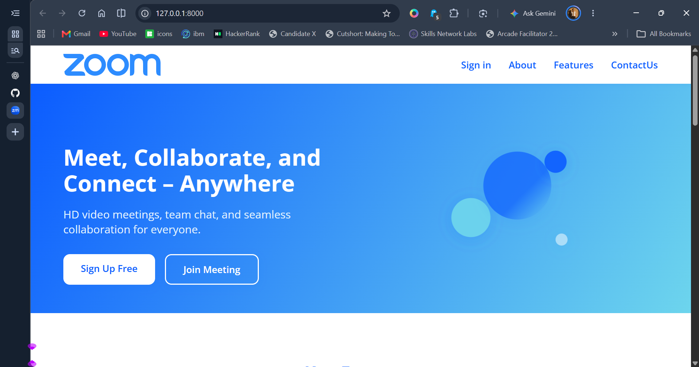

---

### 2. Key Platform Features
Detailed feature breakdown showcasing HD video, collaboration tools, cross-platform capabilities, and security.

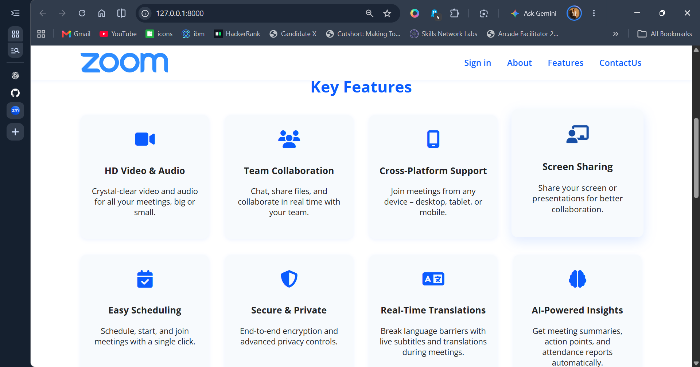

---

### 3. User Testimonials
Social proof and feedback highlighting reliability and call quality.

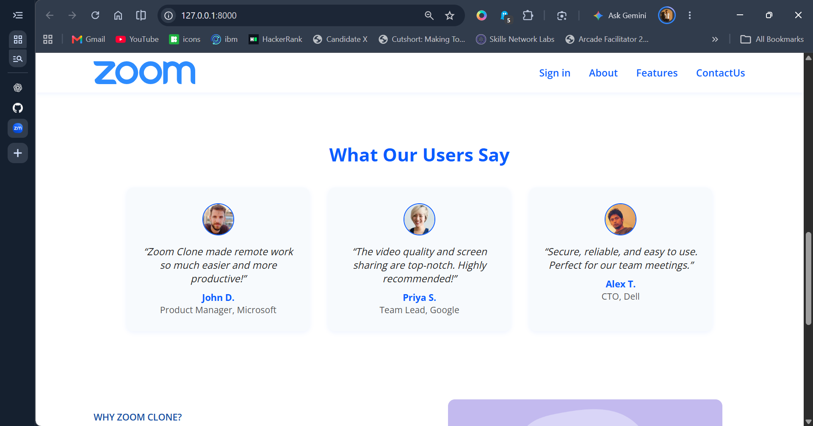

---

### 4. Brand Trust & Platform Overview
Platform values and footer navigation links.

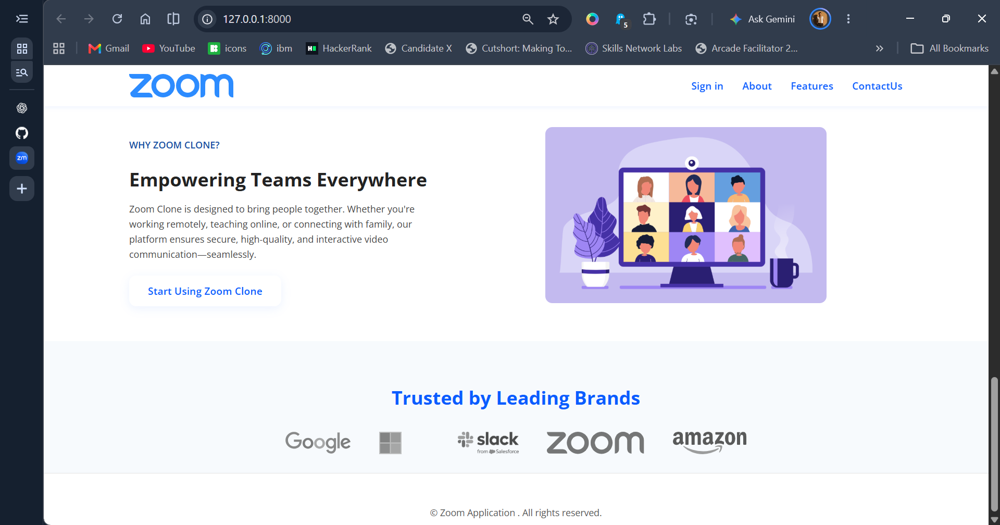

---

### 5. Contact Us Page
Interactive contact form supporting direct email messages and customer support queries.

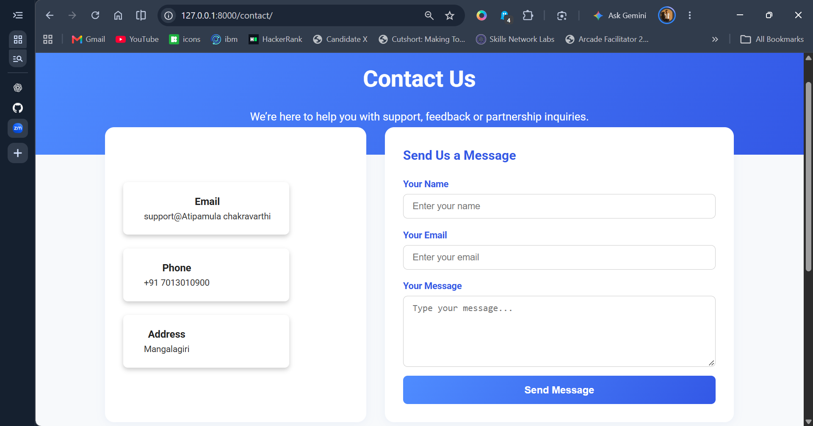

---

### 6. User Login
Glassmorphism login interface with credentials authentication and a password reset link.

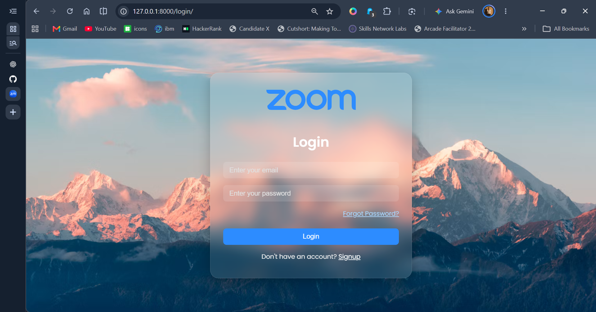

---

### 7. User Registration
User registration portal for new accounts.

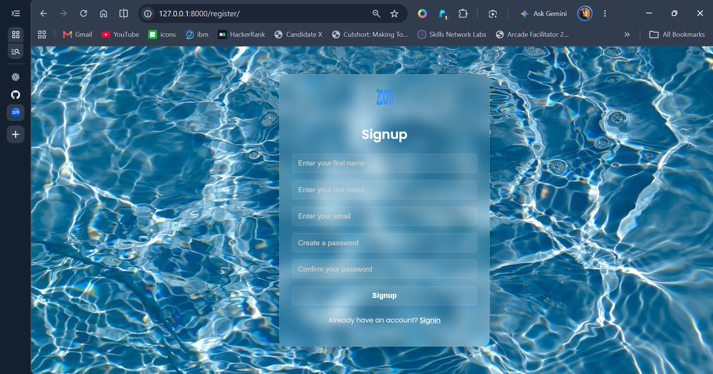

---

### 8. User Dashboard
The central dashboard greeting authenticated users with options to launch a **New Meeting**, **Join Meeting**, or initiate a **Random Call**.

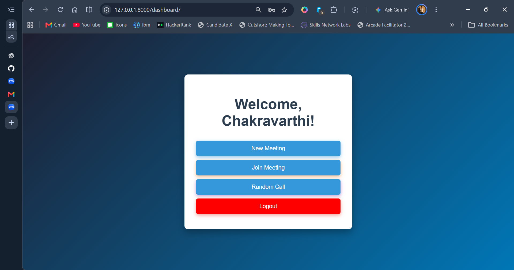

---

### 9. Meeting Pre-Join Lobby
Camera and microphone check lobby before entering the video conference, along with a copyable personal invitation link.

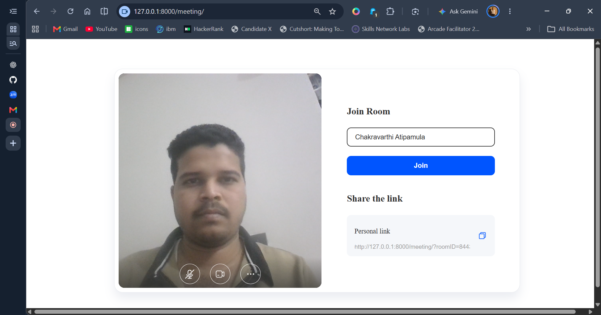

---

### 10. Active Video Conference & Meeting Controls
Active video conference interface equipped with camera/mic controls, layout switcher, participant list, and end-call action.

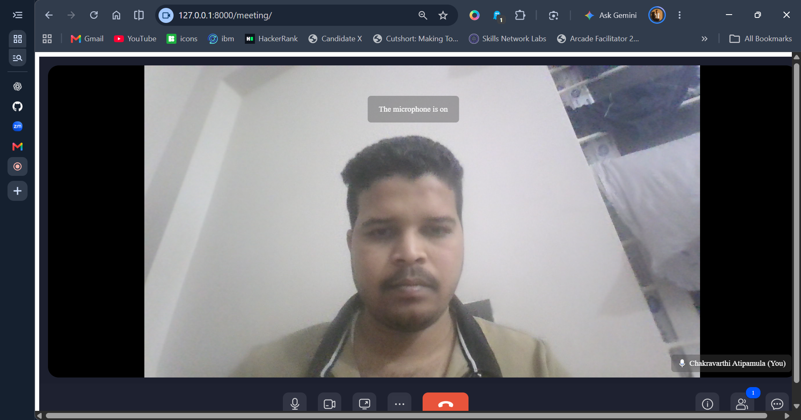

---

### 11. Screen Sharing Selection
Display selection dialog enabling participants to share their entire desktop, specific windows, or browser tabs with audio.

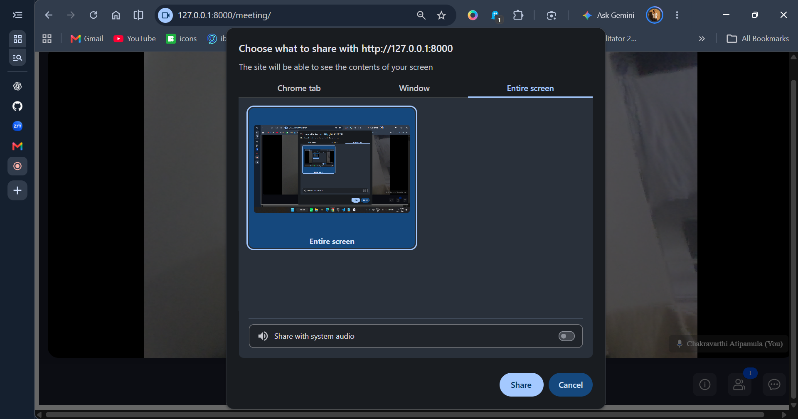

---

### 12. Audio Device Settings & In-Meeting Chat
Live microphone sensitivity meters, device permission settings, and real-time in-room messaging panel.

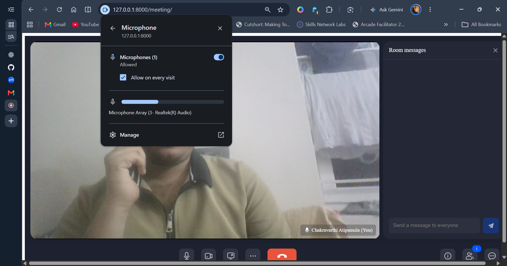

---

### 13. Join Room by ID
Quick-entry portal for joining an ongoing session via a numeric or alphanumeric room code.

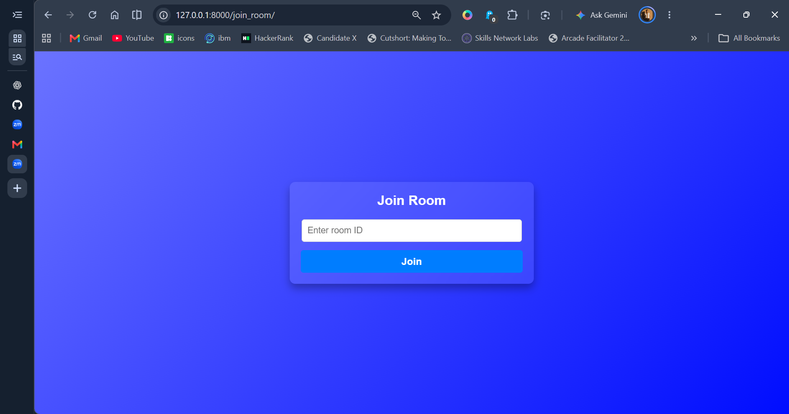

---

## 🛠️ Tech Stack

| Component | Technology | Description |
| :--- | :--- | :--- |
| **Backend Framework** | [Django 5.1](https://www.djangoproject.com/) | Web framework & MTV architecture |
| **Real-Time WebSockets**| [Django Channels 4](https://channels.readthedocs.io/) & [Daphne](https://github.com/django/daphne) | ASGI server & room group signaling |
| **Video & Audio** | [ZegoCloud UIKit Prebuilt](https://www.zegocloud.com/) | WebRTC video calling & screen sharing |
| **API Layer** | [Django REST Framework](https://www.django-rest-framework.org/) | RESTful endpoints & recording upload handlers |
| **Frontend** | HTML5, CSS3, JavaScript | Custom Glassmorphism UI & responsive layouts |
| **Database** | SQLite (Development) / PostgreSQL (Production) | ORM-managed relational database |
| **Static Files** | [WhiteNoise 6.7+](https://whitenoise.readthedocs.io/) | Efficient static file compression & serving |

---

## 🏗️ Project Architecture

```
                      +-----------------------------+
                      |         Web Client          |
                      |   (Browser / HTML5 / JS)    |
                      +--------------+--------------+
                                     |
                    +----------------+----------------+
                    |                                 |
           HTTP / Static Requests             WebSocket Connections
                    |                                 |
                    v                                 v
         +---------------------+            +---------------------+
         |     WSGI Server     |            |  ASGI Server/Daphne |
         |   (Django Views)    |            |  (Django Channels)  |
         +----------+----------+            +----------+----------+
                    |                                  |
                    |                         +--------+--------+
                    |                         |  Channel Layer  |
                    |                         | (InMemory/Redis)|
                    |                         +--------+--------+
                    |                                  |
                    +----------------+-----------------+
                                     |
                    +----------------v----------------+
                    |       Database (SQLite/Postgres)|
                    +---------------------------------+
```

---

## 📂 Project Structure

```
zoom-clone/
│
├── videoconference_app/              # Main application
│   ├── static/                       # Static stylesheets, scripts & assets
│   │   ├── css/                      # CSS styling (joinroom, landing, contact, etc.)
│   │   └── js/                       # Client-side scripts
│   ├── templates/                    # HTML Templates
│   │   ├── index.html                # Landing page
│   │   ├── login.html                # User login
│   │   ├── register.html             # User signup
│   │   ├── dashboard.html            # User dashboard
│   │   ├── joinroom.html             # Join room form
│   │   ├── videocall.html            # Video conference room (ZegoCloud)
│   │   ├── features.html             # Features showcase
│   │   ├── contact.html              # Contact form
│   │   └── forgot_password.html      # Password reset request
│   ├── admin.py                      # Django Admin registration
│   ├── apps.py                       # App configuration
│   ├── consumers.py                  # Channels WebSocket consumer
│   ├── forms.py                      # Django authentication forms
│   ├── middleware.py                 # Active user tracking middleware
│   ├── models.py                     # Meeting & User models
│   ├── routing.py                    # WebSocket URL routing
│   ├── tests.py                      # Unit tests
│   ├── urls.py                       # App URL patterns
│   └── views.py                      # Request handlers & logic
│
├── videoconferencing/                # Project root configuration
│   ├── asgi.py                       # ASGI configuration (WebSockets)
│   ├── settings.py                   # Django settings
│   ├── urls.py                       # Global URL configuration
│   └── wsgi.py                       # WSGI configuration
│
├── screenshots/                      # Application screenshots (ordered 1 to 13)
├── db.sqlite3                        # Local SQLite database
├── manage.py                         # Django management CLI
├── Procfile                          # Process file for Heroku/PaaS deployment
├── requirements.txt                  # Python dependencies
├── start.sh                          # Startup shell script
├── vercel.json                       # Vercel deployment configuration
└── README.md                         # Documentation
```

---

## ⚙️ Getting Started

### Prerequisites

- **Python 3.10+** (Python 3.12 recommended)
- **Git**
- **pip** (Python package manager)

### Installation

1. **Clone the repository**:
   ```bash
   git clone <repository-url>
   cd zoom-clone
   ```

2. **Create and activate a virtual environment**:
   - **Windows**:
     ```powershell
     python -m venv venv
     .\venv\Scripts\activate
     ```
   - **Linux / macOS**:
     ```bash
     python3 -m venv venv
     source venv/bin/activate
     ```

3. **Install dependencies**:
   ```bash
   pip install -r requirements.txt
   ```

### Environment Variables

Create a `.env` file in the project root (or customize existing settings):

```ini
DEBUG=True
SECRET_KEY=your-django-secret-key-here
DATABASE_URL=sqlite:///db.sqlite3

# Optional: Email configurations for Password Reset & Contact Us
EMAIL_HOST_USER=your_email@gmail.com
EMAIL_HOST_PASSWORD=your_app_password

# Optional: Redis Channel Layer (falls back to InMemory if omitted)
# REDIS_URL=redis://127.0.0.1:6379
```

### Database Migrations

Apply the database migrations:

```bash
python manage.py migrate
```

*(Optional) Create a superuser for accessing the Django Admin panel:*
```bash
python manage.py createsuperuser
```

### Running the Server

Start the development server using Daphne (ASGI) or Django manage CLI:

```bash
python manage.py runserver
```

Open your browser and navigate to:
```
http://127.0.0.1:8000
```

---

## 🧪 Running Automated Tests

Run the test suite to verify views, authentication, and routing:

```bash
python manage.py test videoconference_app
```

Expected output:
```
Found 8 test(s).
System check identified no issues (0 silenced).
........
----------------------------------------------------------------------
Ran 8 tests in 5.3s

OK
```

---

## 🌐 Deployment

The project is structured for straightforward deployment on cloud platforms:

- **Heroku / Render**: The included [Procfile](file:///d:/Personal-projects/zoom-clone/zoom-clone/Procfile) and [start.sh](file:///d:/Personal-projects/zoom-clone/zoom-clone/start.sh) are pre-configured with Gunicorn and Daphne.
- **Vercel**: The provided [vercel.json](file:///d:/Personal-projects/zoom-clone/zoom-clone/vercel.json) handles WSGI builds and static assets.
- **Static Assets**: Automatically collected and served via WhiteNoise:
  ```bash
  python manage.py collectstatic --noinput
  ```

---

## 📄 License

This project is licensed under the MIT License - see the LICENSE file for details.
